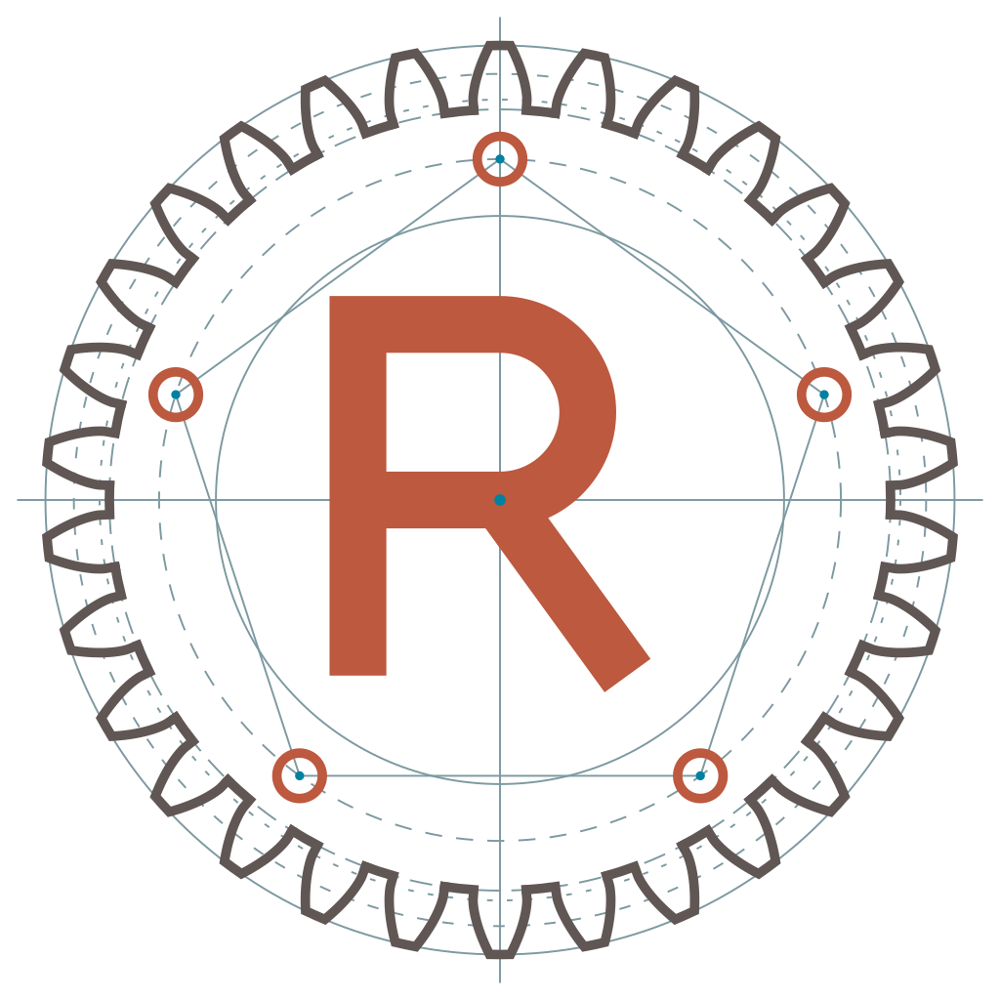

<picture>
  <source media="(prefers-color-scheme: dark)" srcset="assets/logo/rings-white.svg">
  
</picture>

# Rings Network

[](https://github.com/RingsNetwork/rings/actions/workflows/auto-release.yml)
[](https://crates.io/crates/rings-node)
[](https://docs.rs/rings-node/latest/rings_node/)

[](https://github.com/sponsors/RingsNetwork)

**A peer-to-peer network for the sovereign age.**

Rings is a structured peer-to-peer network that runs natively and in the browser. Browser
tabs and native daemons join a unified Chord DHT overlay, address each other by DIDs, and
communicate over direct WebRTC datachannels with no application server in the data path.

## Why Rings

- **A browser tab is a full peer.** It joins the DHT, routes and stores for others, and
  connects browser to browser, with no light client or gateway in between.
- **Privacy is built in.** Onion loops with constant-rate cover and entry guards run natively
  and in the browser; the [hosted console](https://rings.rs/#node) browses the web through
  them from a tab.
- **Wallet keys are identities.** secp256k1 (MetaMask), ed25519 (Phantom), WebCrypto P-256,
  and bip137 keys share one overlay.
- **Protocols are pure state machines.** A protocol owns a namespace; its IO runs in a shell
  that stays isolated within that namespace.
- **Hardened by design.** Messages are signed, delivered at most once, and governed by
  slot-isolated admission and per-origin rate quotas; connection, storage, and queue state is
  strictly bounded. CI model-checks Chord rejoin, runs Miri and ASan/LSan, and runs
  seed-replayable randomized decode-boundary tests.

## Try it

- **Browser:** open [rings.rs/#node](https://rings.rs/#node). Nothing to install.
- **Native:** `curl -fsSL https://rings.rs/install.sh | sh`,
  then `rings init && rings run`. See [Installation](#installation).
- **Web app:** `npm install @ringsnetwork/rings-node`, then follow the
  [guide](https://rings.rs/#guide).

## Status

Active public overlay at the seed `node.rings.rs`, with wire-versioned framing
(`"RINGS\0" ‖ wire_version`, `WIRE_VERSION = 3`) on every frame and handshake. Nodes accept only
their own `WIRE_VERSION` without cross-version negotiation; 1.0 freezes `WIRE_VERSION = 3` and
the public runtime contracts across `1.0.x`, while 2.0 extends the overlay with epoch-randomized
ring placement ([#780](https://github.com/RingsNetwork/rings/issues/780)) and decentralized trust
ranking (DRanking). See [UPGRADING.md](./UPGRADING.md), [ROADMAP.md](./ROADMAP.md), and
[SECURITY.md](./SECURITY.md).

## Where Rings fits

✅ supported · ❌ not provided. Qualifications are listed below the table.

| Network | Browser P2P | Structured P2P | Privacy layer | E2E encryption |
|---|:---:|:---:|:---:|:---:|
| **Rings** | ✅ | ✅ Chord | ✅ Separate layer | ✅¹ |
| **libp2p** | ✅ | ✅ Kademlia² | ❌ | ✅³ |
| **aMule / Kad** | ❌ | ✅ Kademlia | ❌ | ❌⁴ |
| **Nostr** | ❌ | ❌ | ❌ | ✅⁵ |
| **Nym mixnet** | ❌ | ❌ | ✅ Full mixnet path | ✅⁶ |
| **Tor** | ❌ | ❌ Relay network | ✅ Onion circuits | ✅⁷ |
| **I2P** | ❌ | ✅ netDb² | ✅ Tunnel network | ✅⁶ |
| **WebTorrent (browser)** | ✅ | ❌ | ❌ | ✅³ |

Browser P2P means the browser itself connects as a peer; a browser UI or gateway
client does not qualify. Structured P2P includes DHT-based discovery; it does not
imply that application traffic is routed through the DHT. Privacy means network
metadata protection, separate from payload encryption.

1. Rings authenticates every overlay message by DID signature and provides E2E ElGamal stream encryption after a peer handshake.
2. libp2p offers an optional Kademlia DHT. I2P uses a Kademlia-based netDb for discovery; messages travel through tunnels.
3. Encrypted peer connections: libp2p includes circuit-relayed connections; browser WebTorrent uses WebRTC/DTLS.
4. aMule protocol obfuscation is transport-level only. This row covers Kad; eD2k uses indexing servers.
5. Nostr supports encrypted direct messages, such as NIP-44 payloads, alongside public signed events.
6. Between Nym clients or I2P destinations; traffic to external services uses application-layer TLS/HTTPS.
7. Tor provides end-to-end encryption for onion services and pairs with HTTPS for external websites.

[Primary sources](./docs/src/README.md#primary-sources)

## Architecture

```text
┌──────────────────────────────────────────────────────────────────────┐
│  Applications   dWeb · relay/tunnel · your own app                     │
├──────────────────────────────────────────────────────────────────────┤
│  Protocols      built-ins: relay (tcp/udp tunnels), echo —             │  node::extension::protocols
│  (namespaced)   plus any user Protocol, addressed by namespace         │
├──────────────────────────────────────────────────────────────────────┤
│  Extension      pure `Protocol::step` → `Effect` → `Interpret` shell   │  node::extension::ext
│  runtime        over a namespace-scoped `Scope` (send / self-inject)   │
├──────────────────────────────────────────────────────────────────────┤
│  Privacy        onion loops: Sphinx cells over direct edges,           │  crates/node/src/onion
│  (loops)        constant-rate cover, paid admission, exit registry     │
├──────────────────────────────────────────────────────────────────────┤
│  Overlay        Chord DHT: successor / finger tables, stabilization,   │  crates/core
│  (routing +     DID addressing, message relay, network_id isolation,   │
│  encryption)    E2E ElGamal to a DID after its handshake               │
├──────────────────────────────────────────────────────────────────────┤
│  Transport      direct WebRTC datachannels (native + browser/web_sys), │  crates/transport
│                 STUN / ICE / SDP NAT traversal                         │
├──────────────────────────────────────────────────────────────────────┤
│  Identity       DID + secp256k1 / secp256r1 / ed25519 / BLS / bip137   │  crates/core::ecc
└──────────────────────────────────────────────────────────────────────┘
```

The overlay layer provides authenticated DID routing and E2E stream encryption, while the
privacy layer provides anonymous Sphinx onion circuits
([layer contracts](./SECURITY.md#layer-contracts)). Connections are established peer-to-peer
over WebRTC with optional TURN relay support. Supporting crates: `rpc` (JSON-RPC), `measure`
(local peer credit), `gateway` (TUN over onion), `webview` (onion browsing), `network-policy`
(exit egress policy), `codec`, and `derive`.

## Build on Rings

A protocol is a pure state machine registered under a namespace; its interpreter shell
performs the IO.

```rust
provider.register_protocol(Echo, EchoShell)?;
provider.set_backend()?;

// Built-in relay: tunnel a local socket to a peer's service, no server.
let relay = RelayHandle::install(&provider.extensions())?;
relay.register_tcp_service("web".into(), "127.0.0.1:8080".parse()?).await?; // server side
relay.open_tcp_tunnel(local_addr, peer_did, "web".into()).await?;            // client side
```

In the browser, a protocol can be a JS handler: `provider.on(namespace, initialState,
handler)`. Proof systems fit the same boundary: Rings routes and authenticates the
envelopes, and the protocol's shell runs the prover.

| Example | Shows |
|---|---|
| [`native`](./examples/native) | A native node with a custom protocol |
| [`relay`](./examples/relay) | TCP and UDP tunnels to a peer's service |
| [`mailbox`](./examples/mailbox) | SMTP/IMAP mailbox and mail gateway over Rings |
| [`dweb`](./examples/dweb) | A decentralized web app (Yew) |
| [`ffi`](./examples/ffi) | Driving a node over the C FFI |

## Installation

```sh
curl -fsSL https://rings.rs/install.sh | sh
```

The installer detects macOS (`aarch64`, `x86_64`) or Linux (`x86_64` static musl, `aarch64`
gnu), downloads the matching [release](https://github.com/RingsNetwork/rings/releases)
archive, verifies its SHA-256 checksum, and installs `rings` to `/usr/local/bin` (when
writable) or `~/.local/bin`. Re-run the same command to upgrade in place, or pass
`--version vX.Y.Z` (`curl -fsSL https://rings.rs/install.sh | sh -s -- --version v1.0.0-pre.1`)
to pin a release.

- **Cargo:** build with the toolchain pinned in [`rust-toolchain.toml`](./rust-toolchain.toml):

  ```sh
  cargo +1.97.0 install --locked rings-node
  ```

- **Source:** `git clone https://github.com/RingsNetwork/rings && cd rings && cargo install --path crates/node`
- **Wasm:** see [Build for Wasm](./docs/src/build-for-wasm.md).

### Running persistently

Static `systemd` (Linux user unit) and `launchd` (macOS LaunchAgent) service definitions
live under [`contrib/`](./contrib/README.md).

## Documentation

| | |
|---|---|
| [rings.rs/docs](https://rings.rs/docs/) | The book: operating nodes, browser and FFI runtimes, protocol internals |
| [UPGRADING.md](./UPGRADING.md) | 1.0 frozen contracts and upgrade checklist |
| [SECURITY.md](./SECURITY.md) | Security architecture, layer contracts, and vulnerability reporting |
| [ROADMAP.md](./ROADMAP.md) | Milestones and tracks |
| [llms.txt](./llms.txt) | Project map for AI agents |
| [`frontend`](./frontend) | Source of rings.rs and the browser extension |
| [@RingsNetworkio](https://x.com/RingsNetworkio) | Announcements |

## Whitepaper

- [Rings whitepaper](./papers/rings.pdf) ([LaTeX](./papers/rings.tex), [build notes](./papers/README.md))
- [DRanking](./papers/dranking.pdf): decentralized trust and ranking protocol for 2.0, backed
  by signed [service-receipt evidence](./docs/src/advanced-topic/dranking-service-receipts.md).
- [Finger convergence](./papers/finger-convergence.pdf): range-proved finger convergence.

To cite Rings:

```bibtex
@misc{rings-network,
  author = {Ryan J. Kung},
  title = {Rings: A peer-to-peer network for sovereign age},
  year = {2023},
  month = feb,
  url = {https://github.com/RingsNetwork/rings/blob/master/papers/rings.pdf},
  note = {Repository-owned whitepaper and LaTeX source: https://github.com/RingsNetwork/rings/tree/master/papers}
}
```

## Contributing

See [CONTRIBUTING.md](./CONTRIBUTING.md).

## License

Rings is released under the GNU Affero General Public License, version 3.0 only
([AGPL-3.0-only](./LICENSE)). Works derived from it must be released under the same license,
and the AGPL's network clause extends that obligation to services that offer Rings over a
network: a product or hosted service built on Rings must publish its source.

A commercial license for use outside the AGPL's terms is available from Rings Network on
request. The Rings Network name, logo, and the hosted [rings.rs](https://rings.rs) service are
not covered by the software license.
