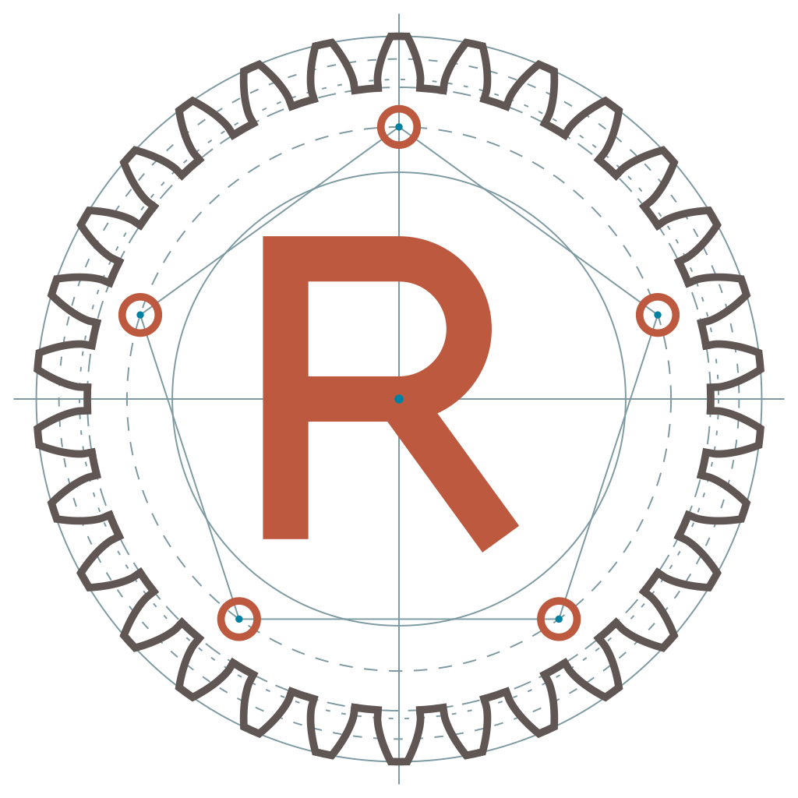

<picture>
  <source media="(prefers-color-scheme: dark)" srcset="https://raw.githubusercontent.com/RingsNetwork/rings/master/assets/logo/rings-white.svg">
  
</picture>


Rings Core
===============

[](https://github.com/RingsNetwork/rings/actions/workflows/auto-release.yml)
[](https://crates.io/crates/rings-node)
[](https://docs.rs/rings-node/latest/rings_node/)


# Architecture

The Rings Network architecture is streamlined into five distinct layers.

#### Runtime Layer

The design goal of Rings Network is to enable nodes to run in any environment, including browsers, mobile devices, Linux, Mac, Windows, etc. To achieve this, we have adopted a cross platform compile approach to build the code. For non-browser environments, we use pure Rust implementation that is independent of any system APIs, making our native implementation system agnostic. For browser environments, we compile the pure Rust implementation to WebAssembly (Wasm) and use web-sys, js-sys, and wasm-bindgen to glue it together, making our nodes fully functional in the browser.

#### Transport Layer

The transport layer of Rings Network is based on WebRTC protocol, which provides browsers and mobile apps with real-time communication capabilities through simple interface.

The WebRTC protocol obtains the optimal connection path between nodes by exchanging SDP (Session Description Protocol), which can be either TCP or UDP. In the Rings Network, we use WebRTC's data channel to implement data communication. For a typical ICE (Interactive Connectivity Establishment) process, it can be described as follows:

Assuming Node A and Node B want to create a WebRTC connection, they would need to exchange a minimum of three messages with each other:

**ICE Scheme:**

1. Peer A: { create offer, set it as local description } -> Send Offer to Peer B
2. Peer B: { set receiveed offer as remote description create answer set it as local description Send Answer to Peer A }
3. Peer A: { Set receiveed answer as remote description }

For native implementation, the transport layer is based on `webrtc.rs`, and for browser case, we implemented based on `web_sys` and `wasm_bindgen`.

To check the implementation of transport layer: https://github.com/RingsNetwork/rings/tree/master/crates/transport


#### Network Layer

The network layer is the core component of the Rings Network, responsible for DID (Decentralized Identifier) discovery and services routing within the network. The Rings Network employs the Chord DHT (Distributed Hash Table) algorithm as the implementation for its network layer, pairing cryptographic DID authentication with slot-isolated admission and multi-replica storage. See the repository [security architecture and threat model](../../SECURITY.md).

The Chord algorithm forms a structured circular topology among participating nodes with O(log(N)) lookup complexity.

#### Protocol Layer

In the protocol layer, nodes address one another by 160-bit Decentralized Identifiers (DIDs) placed around the modular ring `Z / 2^160 Z` — a finite commutative ring and cyclic additive group of order `2^160` (not a field, since `2^160` is composite), whose modular subtraction `(b - a) mod 2^160` defines clockwise Chord distance and whose power-of-two offsets `(n + 2^k) mod 2^160` define finger-table slots.

At the protocol layer, we have implemented the concept of a Delegated Session Key (`DelegateeKey`), which supports multiple cryptographic verification schemes associated with a DID, including ECDSA-secp256k1, EIP-191, BIP-137, ECDSA-secp256r1, EdDSA-ed25519, and BLS12-381; see the [deployment models](../../SECURITY.md#deployment-models) in the security architecture.

#### Application Layer

Core authenticates, replay-checks, and delivers application payloads through its single-claim application inbox; `rings-node` layers pure `Protocol::step` state machines and namespace-scoped `Interpret` effect shells on top.

# Migration Notes

- `Delegation::delegator_pubkey()` now only returns legacy secp256k1-compatible account public keys. For secp256r1, Ed25519, and BLS12-381 accounts, use `Delegation::delegator_verification_pubkey()` or `Delegation::delegator_verifier()`.

# Build

#### Build for native

```sh
cargo build -p rings-core
```

#### Build for wasm

```sh
cargo build -p rings-core --target wasm32-unknown-unknown --features wasm --no-default-features
```
