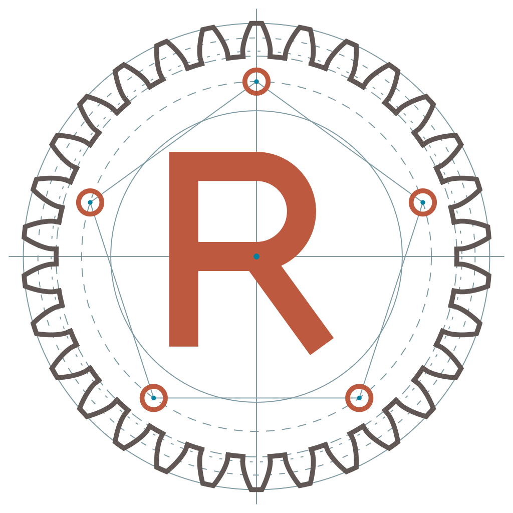

<picture>
  <source media="(prefers-color-scheme: dark)" srcset="https://raw.githubusercontent.com/RingsNetwork/rings/master/assets/logo/rings-white.svg">
  
</picture>


Rings Core
===============

[](https://github.com/RingsNetwork/rings/actions/workflows/auto-release.yml)
[](https://crates.io/crates/rings-core)
[](https://docs.rs/rings-core/1.0.0/rings_core/)


# Architecture

Rings Core implements the structured Chord overlay, cryptographic identity and delegation, fair bounded admission, and multi-replica DHT storage (`WIRE_VERSION = 6`) across five architectural layers.

#### Runtime Layer

Rings targets both native platforms (Linux, macOS, Windows) and WebAssembly (`wasm32-unknown-unknown` in browsers). Asynchronous scheduling, timers, and locks are abstracted behind `rings-runtime` (`tokio` on native targets via `std`, and browser WebAssembly bindings via `wasm`).

#### Transport Layer

Transport mechanics are decoupled into [`rings-transport`](../transport/README.md) (`TransportInterface` and `ConnectionInterface`), supporting native `webrtc.rs`, browser `web-sys` WebRTC, and in-memory `dummy` backends with TURN / TURN-over-TCP support, generic multi-step `HandshakeStep` (`0..=8` steps), `MIN_MAX_MESSAGE_SIZE = 6145`, and four-lane credit flow control.

In a typical 2-step ICE exchange between Peer A and Peer B:

1. Peer A: create offer, set local description -> send offer to Peer B
2. Peer B: set received offer as remote description, create answer, set local description -> send answer to Peer A
3. Peer A: set received answer as remote description

#### Network Layer

The network layer implements a range-proved Chord DHT over 160-bit DIDs:

- **Structured ring & lookup**: logarithmic $O(\log N)$ finger routing, periodic stabilization and finger repair, non-transitive bidirectional/relay gap bridging, and voluntary `Leave` carrier handoff.
- **Fair admission & quotas**: connection `SlotRoster` accounting (`Principal::Slot`, `Principal::Local`, `Principal::Inbox`) paired with per-origin and per-relay quotas and replay protection (`WIRE_VERSION = 6`).
- **Storage & replication**: multi-replica key-value storage, bounded caches, optional LZ4 payload compression, and authenticated CRDT topics (`SignedDataMutation`).
- **Threat model**: see the repository [security architecture and threat model](../../SECURITY.md).

#### Protocol Layer

Nodes address one another by 160-bit Decentralized Identifiers (DIDs) placed around the modular ring `Z / 2^160 Z` — a finite commutative ring and cyclic additive group of order `2^160` (not a field, since `2^160` is composite), whose modular subtraction `(b - a) mod 2^160` defines clockwise Chord distance and whose power-of-two offsets `(n + 2^k) mod 2^160` define finger-table slots.

Delegated Session Keys (`DelegateeKey`, `DelegationBuilder`, `Delegation`) bind ephemeral session keys to an account DID across six supported verification schemes: `ECDSA-secp256k1`, `EIP-191`, `BIP-137`, `ECDSA-secp256r1`, `EdDSA-ed25519`, and `BLS12-381`; see the [deployment models](../../SECURITY.md#deployment-models) in the security architecture.

#### Application Layer

Core authenticates, replay-checks, and delivers application payloads through its single-claim application inbox; `rings-node` layers pure `Protocol::step` state machines, Sphinx onion pipelines, and namespace-scoped `Interpret` effect shells on top.

# Migration Notes

- `Delegation::delegator_pubkey()` now only returns legacy secp256k1-compatible account public keys. For secp256r1, Ed25519, and BLS12-381 accounts, use `Delegation::delegator_verification_pubkey()` or `Delegation::delegator_verifier()`.

# Features

- `default`: enables `std` and `curve-ristretto255`.
- `std`: native `tokio` / `rings-runtime/tokio` support.
- `curve-ristretto255`: enables the Ristretto255 ElGamal group adapter (login/signature algorithms remain unconditionally enabled).
- `wasm`: enables `wasm32-unknown-unknown` browser runtime and JS interop bindings (`--no-default-features --features wasm`).
- `dummy`: enables in-memory deterministic simulation transport (`rings_core::dummy_simulation`).
- `experimental`: deprecated compatibility alias for `std`.

# Build

#### Build for native

```sh
cargo build -p rings-core
```

#### Build for wasm

```sh
cargo build -p rings-core --target wasm32-unknown-unknown --features wasm --no-default-features
```
