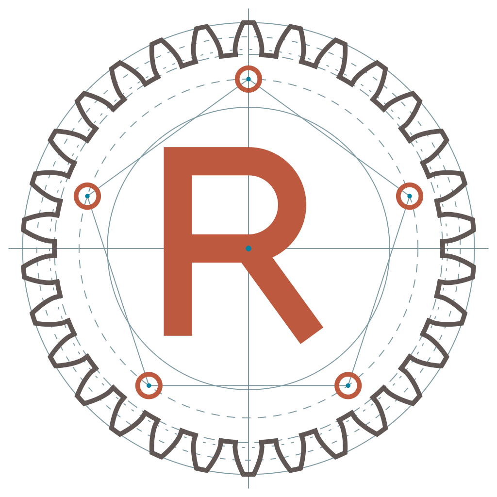

<picture>
  <source media="(prefers-color-scheme: dark)" srcset="https://raw.githubusercontent.com/RingsNetwork/rings/master/assets/logo/rings-white.svg">
  
</picture>

Rings Derive
===============

Procedural macro crate shared by Rings workspace crates.

## Macros

- `#[wasm_export]`: attribute macro that conditionally attaches `#[wasm_bindgen::prelude::wasm_bindgen]` when compiling for `target_family = "wasm"` (for structs that must be exported as JS classes, use `wasm_bindgen` directly). It rejects attribute arguments at compile time.

## Features

- `wasm`: declares WASM export compatibility across Rings build configurations.
