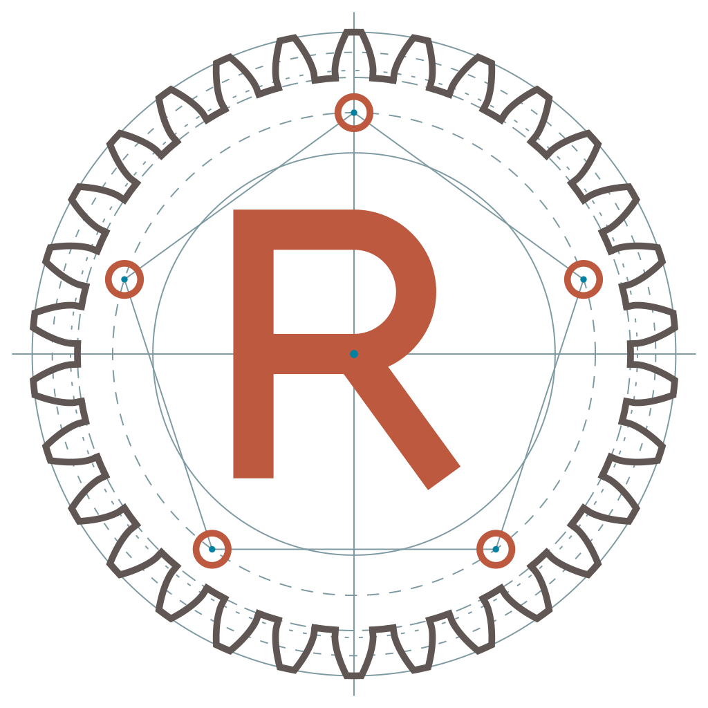

<picture>
  <source media="(prefers-color-scheme: dark)" srcset="https://raw.githubusercontent.com/RingsNetwork/rings/master/assets/logo/rings-white.svg">
  
</picture>

Rings RPC
===============

`rings-rpc` provides the JSON-RPC 2.0 method catalog (`method::Method`), listener authorization classes (`method::AuthorizationClass`), typed request/response DTOs (`protos`), error types (`error`), and authenticated HTTP client (`jsonrpc`) shared by `rings-node`, `rings-tui`, and external tools.

The former HTTP service-backend DTOs (`rings_rpc::types::{HttpRequest, Timeout}`) were removed when the extension registry and relay protocol replaced that backend; these DTOs are not used by the JSON-RPC client or current request types in `protos`.

## Method authorization classes

`Method::authorization_class` separates public HTTP-handshake methods from gated node-control methods on the external listener:

- **`AuthorizationClass::Public` (external listener)**: `nodeDid`, `answerOffer`, and `acceptAnswer`. `nodeDid` exposes the DID being dialed, `answerOffer` is bound by the peer's signed offer payload, and `acceptAnswer` is guarded by a live pending `transport_id` and its signed payload.
- **`AuthorizationClass::Gated`**: all other methods (`connectPeerViaHttp`, `connectWithDid`, `connectWithSeed`, `listPeers`, `createOffer`, `disconnect`, `sendBackendMessage`, `sendE2eHandshake`, `sendE2eMessage`, `publishMessageToTopic`, `fetchTopicMessages`, `registerService`, `lookupService`, `lookupOnlineNodes`, `lookupOnionExits`, `nodeInfo`, `peerMeasurement`, `listPeerMeasurements`) require the node bearer token on every listener.

## Authenticated Rust clients

`jsonrpc::Client::new` and `with_bearer_token` return `Result`. Bearer credentials require HTTPS, except HTTP to a parsed IPv4 loopback address (`127.0.0.0/8`) or IPv6 loopback (`::1`). HTTP hostnames, including `localhost`, are rejected; use `http://127.0.0.1:50000` or `http://[::1]:50000` for a local node. URL userinfo and fragments are also rejected for authenticated endpoints.

Native RPC clients disable redirects and ambient proxies by default. This prevents redirect downgrade and keeps the loopback HTTP exception from sending credentials through an ambient proxy. Custom native DNS pins, TLS roots, and timeouts are retained through `with_http_client_builder`; it replaces `with_http_client`, since an already-built transport cannot have its redirect policy secured. Callers that need to reach a remote endpoint through an explicit HTTP(S) proxy on native targets can opt in with `with_http_client_builder_and_proxy`, which clears ambient proxy variables before installing the proxy and requires `https://` whenever a credential is attached. Normal TLS certificate validation remains enabled by default. Authenticated browser RPC uses Fetch with `redirect: "error"`; its transport settings are controlled by the browser rather than the supplied reqwest builder. Unauthenticated HTTP endpoints remain supported.

## JSON-RPC methods

The method reference, with every method's params, result, listener, and authorization, is the [API page of the Rings book](https://rings.rs/docs/jsonrpc.html) ([source](../../docs/src/jsonrpc.md)).
