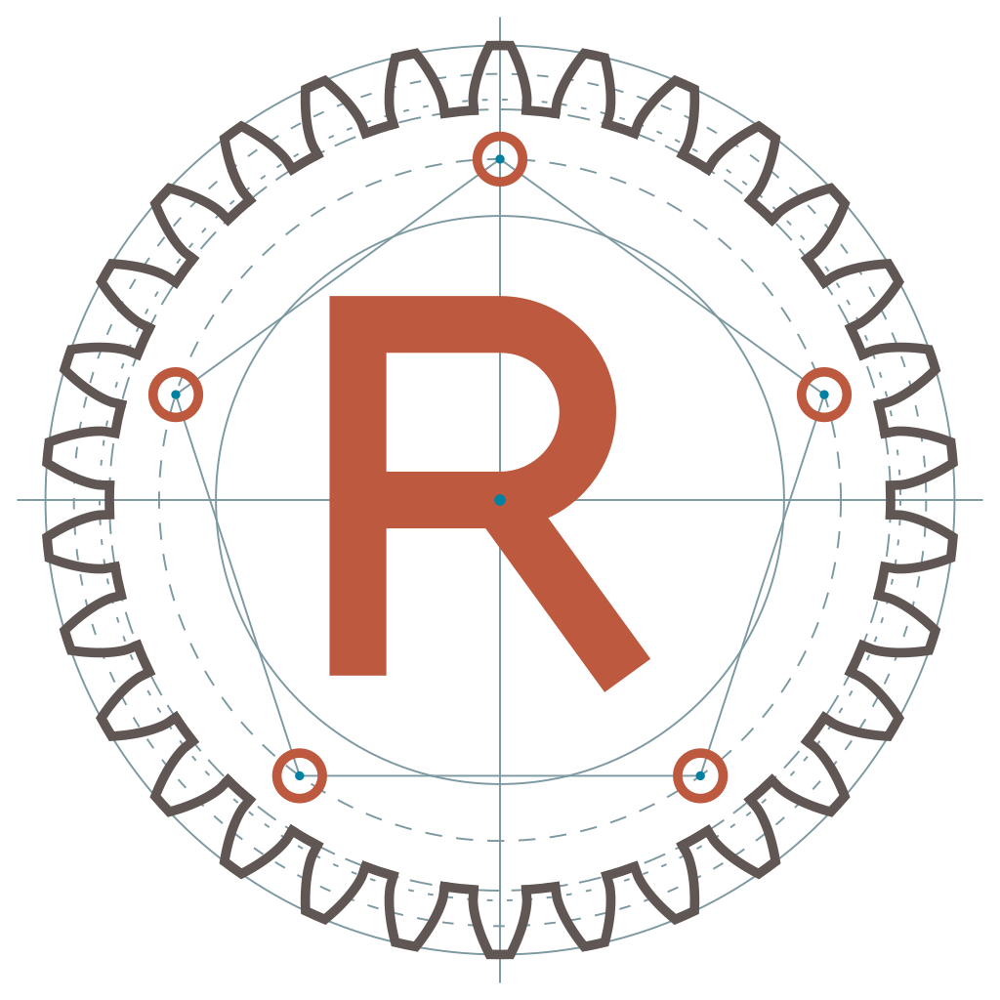

<picture>
  <source media="(prefers-color-scheme: dark)" srcset="https://raw.githubusercontent.com/RingsNetwork/rings/master/assets/logo/rings-white.svg">
  
</picture>

# Rings Transport

[](https://github.com/RingsNetwork/rings/actions/workflows/auto-release.yml)
[](https://crates.io/crates/rings-transport)
[](https://docs.rs/rings-transport/1.0.0/rings_transport/)


This crate implements the transport layer for the Rings Network across native, browser WebAssembly, and simulation targets. It provides three Rust-based implementations behind [`TransportInterface`](crate::core::transport::TransportInterface) and [`ConnectionInterface`](crate::core::transport::ConnectionInterface):

## Implementations

* Native Transport (`native-webrtc`)

  Based on `webrtc.rs`, supporting UDP, STUN, TURN, and TURN-over-TCP / TURNS via the built-in TURN-over-TCP/TLS bridge (`turn_tcp`) for native targets.

  ```sh
  cargo build -p rings-transport --features native-webrtc
  ```

* WebSys Transport (`web-sys-webrtc`)

  Based on `wasm_bindgen` and `web_sys` for browser WebAssembly targets.

  ```sh
  cargo build -p rings-transport --target wasm32-unknown-unknown --no-default-features --features web-sys-webrtc
  ```

* Dummy Transport (`dummy`)

  In-memory transport used exclusively for deterministic tests and simulations.

  ```sh
  cargo build -p rings-transport --features dummy
  ```

## Transport Contract & Capabilities

- **Generic multi-step handshake (`HandshakeStep`)**: supports zero- to eight-step handshakes (`MAX_HANDSHAKE_STEPS = 8`, `DEFAULT_MAX_HANDSHAKE_STEP_BYTES = 4096`), covering pre-provisioned (`Done`), 1-step announce (`SendFinal`), 2-step offer/answer (`Send` + `SendFinal`), and 3-step challenge protocols.
- **Four-lane credit flow control & framing**: every connection multiplexes four ordered `ChannelLane` streams governed by cumulative receiver-advertised credit windows (`credit`) and enforces `max_message_size() >= MIN_MAX_MESSAGE_SIZE` (`6145` bytes) up to `MAX_CHANNEL_MESSAGE_SIZE` (`65536` bytes) so unchunked control frames fit whole without fragmentation.
- **ICE gathering & TURN-over-TCP/TLS**: `IceCandidateTier` models `Host < Reflexive < Relay` gathering settle rules, and native connections bridge `?transport=tcp` / `turns://` relay URLs to the WebRTC stack.

## Tests

```sh
cargo test -p rings-transport --features native-webrtc
```

```sh
wasm-pack test --headless --chrome crates/transport -- --no-default-features --features web-sys-webrtc
```

## Connection lifecycle and supported configuration

Retain the `ConnectionRef` returned by `new_connection` across asynchronous work. Use `close_connection_if_current(&connection)` to retire only that physical connection generation. `Pool::safely_remove_if_current` checks slot identity before removal and physical close. Enumerate IDs with `connection_ids`, then resolve the current reference with `connection`; do not assume a snapshot pins later lookups. The CID-only close and connection-list APIs and the debug string stats API were removed in issue #787. Structured core measurement remains a separate API.

ICE configuration supports password credentials only. The URL parser already produces this credential type; deserializing `Oauth` now fails instead of allowing native to fall back to password fields or mapping browser credentials differently.

The backend-free `--no-default-features` build compiles with `rings_runtime::sleep` and platform-agnostic runtime primitives without dragging in a WebRTC stack. The native WebRTC backend requires a Tokio runtime for its send, close, TURN-TCP bridge, and timer tasks.

Native and WASM sends share a one-shot close actor with exclusive state and physical-close ownership. Caller and continuation report failures through a bounded mailbox only after synchronous generation fencing. Pure reducers govern failure observations and actor transitions; finite-state exploration and real actor conformance tests check the ownership laws. The shared lifecycle, polling owner, and checked queue accounting live in `core::send`; platform adapters supply fencing, mailbox delivery, and scheduling (Tokio for native, `spawn_local` for WASM).

Failed sends share the same cleanup-completion boundary on both backends. The queue operation is private: native preparation retains a real channel lock and requires an admission lease before it becomes a continuation; the WASM entry accepts only a synchronous primitive. State publication is an explicit reducer effect, and terminal destruction produces no duplicate notification.
